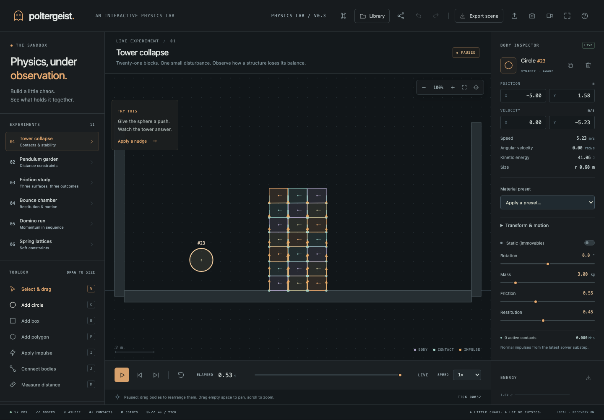

# Poltergeist

**Physics, under observation.** A local-first, interactive 2D physics lab powered by a custom Rust engine running in WebAssembly. Build mechanisms, inspect their contacts, rewind motion, and keep or share your experiments.

## Get started

Install a current stable [Rust toolchain](https://rustup.rs/) and Node.js 24 LTS (the version in `.nvmrc`). The checked-in Rust toolchain configuration installs the WASM target, formatter, and Clippy.

```sh
npm ci
npm run dev
```

Open **http://127.0.0.1:5173**. No account, server database, API key, or external font is required. Simulation and saved experiments stay on your device.



[Saved-experiment library](docs/screenshots/library.png) · [Mobile layout](docs/screenshots/mobile.png)

Web changes reload automatically. After changing Rust, run `npm run wasm` and refresh the page. The physics crates have no external dependencies and compile offline after the Rust toolchain is installed.

## Explore the lab

Start with **Tower collapse** and apply a nudge. Pause the experiment, select a body, and enable contacts, impulses, velocities, or trails to see what is happening. Try the pendulums, friction ramps, bounce chamber, domino chain, spring lattices, and motorized mechanisms, high-speed collision lab, cradle study, and 160-body stress chamber; the empty chamber is yours to build in.

### Build and edit

- Circles, oriented boxes, and regular convex polygons with 3–8 sides. Click to place; drag to size. Hold Shift for a square box.
- Dynamic bodies or static scenery, area-based mass, optional placement snapping to a 0.25 m grid, and stylized Default/Wood/Rubber/Steel/Ice material presets.
- Precise position, linear velocity, spin, rotation, mass, friction, and restitution controls. Make a body static, stop its motion, duplicate it, or delete it.
- Rods, ropes, damped springs, and pins; connect bodies to each other or to the world. Edit rest length, spring frequency/damping, and pin motor speed/torque.
- Pull bodies through a capped spring while running; move them directly while paused. Aim impulses from the clicked point on the body.
- Snapshot undo/redo for edits, impulses, world settings, scene loads, and imports. Slider edits coalesce into a single undo step.

### Observe and navigate

- Pause, reset, single-step forward/backward, slow motion, and a bounded ten-second timeline.
- Contact normals and impulses, velocity vectors, bounding boxes, motion trails, sleep-state highlighting, and a scale-aware grid.
- A live kinetic/potential/total energy chart and energy CSV export. Values are expressed in SI units.
- World-space measurement annotations: drag a ruler between two points; up to ten measurements are retained.
- Zoom, pan, pinch, reset view, follow a selection, and fullscreen.
- Search the object list by shape, ID, or state. Use the command menu to search scenes, tools, and actions.
- Keyboard-accessible creation: focus the chamber, choose a shape tool, move the placement cursor with arrow keys, and press Enter to place.

### Keep and share

- **Library:** save up to 24 named experiments in this browser; search, rename, open, export, or remove them. Saving an existing name updates that experiment. Removal requires a second click.
- **Recovery:** the current scene is saved every three seconds and when the page loses visibility. A restore banner appears on your next visit; nothing replaces your current scene without choosing Restore.
- **Share:** create a compressed URL containing the scene in its fragment. Opening it creates an independent, paused copy. It is a snapshot, not collaborative synchronization.
- **Portable files:** validated JSON scene import/export; PNG snapshots; video of the chamber for up to 30 seconds (when the browser supports canvas recording); recent energy samples as CSV.
- **Offline:** production builds include an installable app manifest and a service worker. After one successful online visit, the app shell and WASM engine can reload without a connection. App updates are offered explicitly and save a recovery snapshot before reloading.

Browser storage can be cleared or unavailable. Export important experiments as JSON for an independent backup. Shared links include scene data and should be treated as shareable copies of that data. Oversized scenes use JSON exports instead of links.

## Controls

| Action                                              | Mouse / touch                             | Keyboard                              |
| --------------------------------------------------- | ----------------------------------------- | ------------------------------------- |
| Play / pause                                        | Transport button                          | Space                                 |
| Step forward / backward                             | Transport buttons / timeline              | N or → / ←                            |
| Select, circle, box, polygon, impulse, joint, ruler | Toolbox                                   | V C B P I J M                         |
| Cycle joint kind                                    | Connection options                        | J again                               |
| Place a body                                        | Click or drag to size                     | Focus chamber, arrows, Enter          |
| Static placement                                    | Dynamic / Static toggle                   | S                                     |
| Rotate selection                                    | Inspector                                 | Q / E: 15°; Shift: 1°                 |
| Pan / zoom                                          | Empty-space or right drag; wheel or pinch | + / −; 0 resets view                  |
| Follow selection                                    | View control                              | F                                     |
| Undo / redo / duplicate                             | Toolbar / inspector                       | ⌘Z / ⇧⌘Z / ⌘D (Ctrl on Windows/Linux) |
| Save / open library                                 | Library                                   | ⌘S / Ctrl+S                           |
| Command menu                                        | Command icon                              | ⌘K / Ctrl+K                           |
| Delete / cancel                                     | Inspector / close buttons                 | Delete / Esc                          |
| Help                                                | Help icon                                 | ?                                     |

Typing in fields preserves normal text-editing shortcuts. Keyboard-focused controls keep their native behavior, including arrow keys on sliders. Dialogs use native focus containment and Escape dismissal.

## Physics and performance

The headless engine implements:

- Sweep-and-prune broad-phase candidate generation and stable contact ordering.
- Circle, box, and regular-polygon narrow phases; separating-axis polygon collisions with clipped contact manifolds.
- Accumulated sequential normal/friction impulses, warm starting, a restitution threshold, and separate positional correction.
- Distance, maximum-distance, soft spring, and motorized point constraints.
- Island sleeping and transitive wake-up when a resting structure is disturbed.
- Two physics substeps per fixed 60 Hz tick; bounded catch-up work so a delayed frame cannot create an unbounded simulation backlog.
- Swept-circle collision handling against fixed circles, boxes, and regular polygons, including rounded vertex hits. Up to four impacts are handled per substep. Other shape pairs remain discrete.
- Full solver checkpoints in the recent timeline: bodies, properties, sleep timers, contacts, warm-start caches, joints, settings, and the clock. Tests verify that unchanged same-build continuations reproduce contact-heavy and joint-heavy runs exactly. Structural edits re-anchor the timeline.

The browser decodes WASM state after ticks and edits, rather than re-reading a paused world on every animation frame. Optional interpolation smooths rendering between fixed ticks without changing exported or inspected state. Energy samples are captured per physics tick, including when multiple ticks fit inside a render frame. Simulation pauses in hidden tabs and while dialogs are open.

### Units and conventions

Meters, kilograms, seconds, and radians are canonical; positive Y points upward. Only rendering converts to pixels. Contact normals point from A to B. Contact and joint impulses are **N·s** from the latest solver substep, not forces or whole-frame totals. Restitution combines with `min`, friction with the geometric mean. Potential energy includes gravity relative to y = 0 and stored spring energy. Materials are stylized 2D presets with mass proportional to area, not measured real-world 3D material properties.

Bodies and joints are limited to 256 each. IDs are bounded to 16,777,215 so the packed f32 render ABI preserves them exactly. Speeds are capped; escaped dynamic bodies beyond ±300 m or below −60 m are removed with their constraints.

## Build, test, and ship

```sh
npm run check             # Svelte and TypeScript diagnostics
npm run test:unit         # Scene boundaries, storage, links, undo, camera, interpolation
npm run test:core         # Native physics and replay regressions
npm run lint:rust         # Rust formatting and Clippy
npx playwright install chromium webkit
npm run test:e2e          # Desktop Chromium/WebKit + mobile Chromium workflows and accessibility checks
npm run test:production   # Production build and actual offline WASM reload
npm run build            # Generate dist/ including the versioned offline shell
npm run preview          # Preview the production app on localhost:4173
npm run format           # Format web, tests, scripts, and Rust
npm run benchmark        # Release WASM tick/frame-packing timings; excludes rendering
```

The GitHub Actions workflow runs the same verification on pushes to `main` and pull requests, and keeps browser traces/screenshots on failure. `package-lock.json` and `Cargo.lock` are checked in. `npm run icons` regenerates app icons from the vector brand mark and requires a Playwright browser.

### Hosting

Serve `dist/` at the root of an HTTPS origin (localhost also works). Every part of the application is static. Serve `.wasm` as `application/wasm`, the manifest as `application/manifest+json`, and JavaScript/CSS with their normal content types. The build uses root-relative asset paths; a subdirectory deployment requires corresponding Vite, manifest, service-worker, and engine URL changes.

Use short revalidation for `index.html`, `poltergeist.wasm`, and `sw.js` (`Cache-Control: no-cache`); hashed assets may use long immutable caching. The generated worker pre-caches a coherent build of the shell and engine, never arbitrary external requests. A new build waits for the explicit Update action before replacing an existing active worker.

## Project map

```text
crates/poltergeist-core/     Physics, collisions, constraints, sleeping, solver checkpoints
crates/poltergeist-wasm/     Scalar WASM commands and versioned packed frames
web/src/engine.ts           Scene validation, WASM boundary, import/export
web/src/App.svelte          Workspace orchestration and input/frame scheduling
web/src/Inspector.svelte    Body, material, motion, and constraint editing
web/src/renderer.ts         Canvas rendering, debug overlays, measurement annotations
web/src/presentation.ts     Render interpolation without altering physics
web/src/view.ts             Camera transforms, cursor-centered zoom, pan
web/src/Library.svelte      Saved-experiment interface and previews
web/src/library.ts          Validated storage and recovery snapshots
web/src/share.ts            Bounded compressed-link encoding and decoding
web/src/CommandPalette.svelte  Searchable actions and experiments
web/src/EnergyChart.svelte  Energy chart and readable values
web/src/undo.ts             Coalesced snapshot undo/redo
web/src/prefs.ts            Optional viewer preferences
web/src/offline.ts          Production service-worker registration and update notices
scripts/build-offline.mjs   Content-versioned app-shell cache generation
scripts/build-wasm.mjs      Dependency-free Rust-to-WASM build
scripts/generate-icons.mjs  Reproducible rasterization of the vector app icon
tests/unit/                Workspace logic regression tests
tests/*.spec.ts            Browser user stories and offline production checks
.github/workflows/ci.yml    Automated verification
```

Scene documents remain **version 2**, with version 1 imports supported. Bodies store shape, pose, material, and motion; joints store kind, body-local anchors, and kind-specific parameters. `b: 0` anchors a joint to the world. JSON exports intentionally exclude solver caches, browser preferences, measurements, and timeline history. The internal render frame is version 3 and includes world settings so rewind and the inspector remain consistent.

## Practical boundaries

This is a production-shaped creative sandbox, not an industrial simulation package. Swept protection currently covers translating circles against fixed scenery; dynamic-dynamic impacts and rotating boxes/polygons can still tunnel. There is no general concave/irregular geometry, compound body support, joint limits, or multithreaded solver. Same-build replay assumes identical subsequent inputs and does not promise bit-identical results across browsers, CPU architectures, or compiler versions. Structural edits start a fresh recorded timeline; undo snapshots and portable JSON restore scene state, not solver history.

The library and recovery are local to one browser origin. Offline use requires a completed online cache installation; clipboard, fullscreen, installation, and video formats depend on browser support. Links are capped at 24,000 characters and decompression at 1 MB. Files are validated before mutation; storage errors leave previously saved experiments intact and offer JSON export as a fallback.

## References

- [Erin Catto: Sequential Impulses](https://box2d.org/files/ErinCatto_SequentialImpulses_GDC2006.pdf)
- [Erin Catto: Soft Constraints](https://box2d.org/files/ErinCatto_SoftConstraints_GDC2011.pdf)
- [Box2D collision documentation](https://box2d.org/documentation/md_collision.html)
- [Box2D simulation documentation](https://box2d.org/documentation/md_simulation.html)
